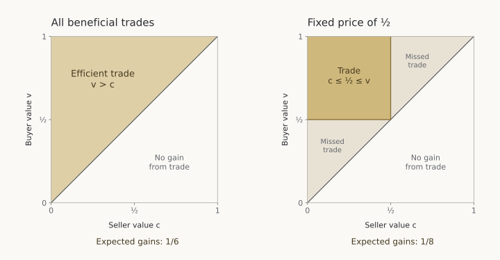

Suppose you want to buy a used bicycle.
Its owner would be willing to part with it for 40 dollars, and you would be willing to pay 70.
A price of 55 makes you both better off.
The potential gain from trade is 30 dollars; the price determines how you divide it.

If those values were public, arranging the trade would be easy.
But the owner does not know your maximum price, and you do not know the owner's minimum.
You have a reason to sound less enthusiastic than you are.
The owner has a reason to insist that the bicycle is particularly hard to give up.

Perhaps a clever bargaining rule could solve this problem.
Ask both sides for their values, set a fair price, and trade whenever the buyer values the bicycle more.
Or run an auction, introduce a mediator, or allow several rounds of offers.

The **Myerson–Satterthwaite theorem** identifies a limit to all these approaches.
With independent private values drawn from overlapping intervals, under the regularity conditions stated below, no rule can simultaneously induce honest reporting, make participation worthwhile for every type, finance itself, and realize every gain from trade.
The result comes from Roger Myerson and Mark Satterthwaite's 1983 paper, [*Efficient Mechanisms for Bilateral Trading*](https://doi.org/10.1016/0022-0531(83)90048-0).

We can see the entire conflict in an example with two uniform distributions.
The proof uses the envelope theorem to calculate what honest reporting requires us to leave each trader, then compares those payoffs with the surplus available.

For a related result with a different starting point, see the companion article on [Milgrom–Stokey's no-trade theorem](/fun-stuff/economics/milgrom-stokey.html).

## A market inside a unit square

There is one indivisible object, one seller, and one buyer.
Write the buyer's value as $$v$$ and the seller's value as $$c$$.
Think of $$c$$ as the opportunity cost of giving up the object.
Assume

$$
v\sim U[0,1],\qquad c\sim U[0,1],
$$

independently.
Each person knows their own value, but knows only the distribution of the other person's value.
Both distributions are common knowledge.
The numbers can represent hundreds of dollars, so $$v=0.7$$ means a willingness to pay 70 dollars.

People are risk neutral, and money enters utility dollar for dollar.
If trade occurs at price $$p$$, the buyer gains $$v-p$$ and the seller gains $$p-c$$, relative to keeping their money and the object where they were.
Their combined gain is

$$
(v-p)+(p-c)=v-c.
$$

Thus **efficient trade** means transferring the object whenever $$v>c$$ and leaving it with the seller whenever $$v<c$$.
Either decision is efficient when the values are equal.
There are no transaction costs or external effects in this example.

Because the joint density is one on the unit square, the expected gain under efficient trade is

$$
\mathbb E[\text{efficient gains from trade}]
=\int_0^1\int_0^v(v-c)\,dc\,dv
=\int_0^1\frac{v^2}{2}\,dv
=\frac16.
$$

This is the total expected surplus available to divide between the two people if no money comes from outside.

## Four requirements that sound reasonable

A **mechanism** is a rule that takes the two reported values and determines whether trade occurs and what each person pays or receives.
We will allow random trade and transfers even when no trade occurs.
We also allow the amount collected from the buyer to differ from the amount paid to the seller.
These freedoms make the impossibility stronger.

Let $$q(v,c)\in[0,1]$$ be the probability of trade, $$t_B(v,c)$$ the payment collected from the buyer, and $$t_S(v,c)$$ the payment made to the seller.
For a randomized mechanism, these transfers denote expected payments over its internal randomization.
Assume the functions are measurable and all expected transfers are finite.

Our four requirements are:

1. **Efficiency.** Trade occurs with probability one when $$v>c$$ and zero when $$v<c$$.
2. **Honest reporting is a best response.** For every value, telling the truth maximizes expected utility when the other person tells the truth. The expectation is over the other person's unknown value. This is *Bayesian incentive compatibility*; it allows ties between truth and other reports.
3. **Participation is voluntary after learning one's own value.** Every buyer type and every seller type expects to do at least as well by participating as by walking away. This is *interim individual rationality*.
4. **No expected outside subsidy.** Expected receipts cover expected payments:

$$
\mathbb E[t_B(v,c)-t_S(v,c)]\geq0.
$$

The last requirement is deliberately weak.
We allow deficits in some realizations if surpluses elsewhere cover them on average.
Requiring the buyer's payment to equal the seller's receipt in every realization would be stricter.

The participation requirement is also modest.
Someone can sometimes regret participating after seeing the other person's value; we ask only that participation be worthwhile given their own information when they enter.
Requiring both people to benefit in every realization would again be stricter.

**Claim.** In the independent-uniform example, no mechanism satisfies all four requirements.

Why consider rules that ask for values directly?
The *revelation principle* supplies the connection to more elaborate bargaining games.
Take an equilibrium of any such game and let a mediator ask for values, then simulate the equilibrium strategies associated with those reports.
If lying to the mediator were profitable, playing the strategy of that other type would have been a profitable deviation in the original game.
Consequently, any equilibrium achieving the four requirements would yield a truthful direct mechanism achieving them too.
The direct-mechanism impossibility therefore rules out that equilibrium as well.

## Why splitting the difference does not solve the problem

A natural proposal is to trade whenever the reported buyer value exceeds the reported seller value, at the midpoint of their reports.
If everyone tells the truth, this is efficient and both sides benefit.
The difficulty is getting them to tell the truth.

Suppose the seller reports honestly, while a buyer with true value $$v$$ reports $$r$$.
Trade occurs for seller values $$c\leq r$$, at price $$(r+c)/2$$.
The buyer's expected payoff is

$$
\int_0^r\left(v-\frac{r+c}{2}\right)dc
=vr-\frac{3r^2}{4}.
$$

This strictly concave expression is maximized at $$r=2v/3$$, which lies in the permitted report interval.
For every $$v>0$$, reporting this smaller number yields $$v^2/3$$, whereas reporting truthfully yields only $$v^2/4$$.
The buyer accepts a lower chance of getting the object in exchange for a better price when trade occurs.

So this particular proposal fails.
To establish an impossibility theorem, we must show why *every* proposal fails.

## What honest reporting costs on the buyer's side

Let the buyer's expected payoff from reporting truthfully be

$$
U_B(v)=\int_0^1\bigl[vq(v,c)-t_B(v,c)\bigr]dc.
$$

This is an expected gain relative to not participating, conditional on the buyer knowing $$v$$.
Incentive compatibility says that reporting truthfully solves the buyer's choice of report:

$$
U_B(v)=\max_{r\in[0,1]}
\int_0^1\bigl[vq(r,c)-t_B(r,c)\bigr]dc,
\qquad r=v\text{ is optimal}.
$$

For the calculation, assume the interim expected payoff from a report is smooth enough to apply the usual **envelope theorem**.
The short technical note below explains why the resulting formulas do not depend on an extra smoothness restriction in this example.

The envelope theorem says to differentiate the objective with respect to the true value, holding the optimal report fixed.
An extra dollar of value matters only when the buyer receives the object.
Thus the marginal payoff is exactly the probability of trade:

$$
U_B'(v)=\int_0^1q(v,c)\,dc=v.
$$

The last equality uses efficiency: a buyer with value $$v$$ buys whenever $$c<v$$, an event with probability $$v$$.
Integrating from zero to $$v$$ gives

$$
\boxed{U_B(v)=U_B(0)+\int_0^v x\,dx
=U_B(0)+\frac{v^2}{2}.}
$$

Voluntary participation requires $$U_B(0)\geq0$$.
Averaging over buyer types yields

$$
\mathbb E[U_B(v)]
=U_B(0)+\int_0^1\frac{v^2}{2}\,dv
\geq\frac16.
$$

The buyer alone must receive at least the entire expected efficient surplus.
These payoffs are **information rents**: gains the mechanism must leave to different types so that they prefer their own outcomes to those assigned to other types.
They arise from incentive constraints, even if nobody has any special bargaining power.

## The seller needs information rents too

Define the seller's expected payoff relative to keeping the object as

$$
U_S(c)=\int_0^1\bigl[t_S(v,c)-cq(v,c)\bigr]dv.
$$

Incentive compatibility again makes the truthful report optimal:

$$
U_S(c)=\max_{r\in[0,1]}
\int_0^1\bigl[t_S(v,r)-cq(v,r)\bigr]dv,
\qquad r=c\text{ is optimal}.
$$

Apply the envelope theorem with respect to the seller's true opportunity cost.
An extra dollar of cost reduces the payoff by a dollar whenever the seller gives up the object.
Under efficient trade, that happens with probability $$1-c$$, so

$$
U_S'(c)=-\int_0^1q(v,c)\,dv=-(1-c).
$$

Integrating from $$c$$ to one gives

$$
\boxed{U_S(c)=U_S(1)+\int_c^1(1-x)\,dx
=U_S(1)+\frac{(1-c)^2}{2}.}
$$

Voluntary participation requires $$U_S(1)\geq0$$.
Consequently,

$$
\mathbb E[U_S(c)]
=U_S(1)+\int_0^1\frac{(1-c)^2}{2}\,dc
\geq\frac16.
$$

The seller must also receive at least the entire expected efficient surplus.

Technical note: why differentiability is harmless here

Neither the trade threshold nor the transfer functions need to be differentiable point by point.
Under the efficient allocation, comparing the truthful report with a report $$h>0$$ higher, and then reversing the comparison, gives

$$
vh\leq U_B(v+h)-U_B(v)\leq(v+h)h
$$

and

$$
-(1-c)h\leq U_S(c+h)-U_S(c)\leq-(1-c-h)h,
$$

whenever both types lie in $$[0,1]$$.
For the buyer, these bounds use the trade probabilities $$v$$ and $$v+h$$; for the seller, they use $$1-c$$ and $$1-c-h$$.
Divide by $$h$$ and let it approach zero.
The corresponding comparisons with a lower type give the same left derivatives.
Thus incentive compatibility itself implies $$U_B'(v)=v$$ and $$U_S'(c)=-(1-c)$$ in the interior.
The same bounds ensure continuity at the endpoints, so integration gives exactly the two formulas above.
This is the incentive-compatibility envelope argument written out directly.

## The contradiction

Add the buyer's and seller's payoffs in any realization:

$$
\underbrace{vq-t_B}_{\text{buyer gain}}
+\underbrace{t_S-cq}_{\text{seller gain}}
=(v-c)q-(t_B-t_S).
$$

Their combined gains equal the surplus created by trade minus any money retained by the mechanism.
Taking expectations, efficiency and the absence of an expected subsidy imply

$$
\mathbb E[U_B(v)]+\mathbb E[U_S(c)]
=\frac16-\mathbb E[t_B-t_S]
\leq\frac16.
$$

But truthful reporting and voluntary participation require

$$
\mathbb E[U_B(v)]+\mathbb E[U_S(c)]
\geq\frac16+\frac16=\frac13.
$$

There is only $$1/6$$ to divide, while the incentive and participation constraints require at least $$1/3$$.
This contradiction proves the claim.

The conflict comes from having to make the same rule work for *all* values.
For a particular pair with $$v>c$$, there is always a price both would accept.
But choosing prices using private reports changes the incentives to make those reports.
Each side must be left enough expected gain to make honest reporting worthwhile, while even the least enthusiastic types must be willing to enter.
Efficient trade does not generate enough surplus to satisfy both sides' constraints.

The [commitment folk theorem](/fun-stuff/economics/kalai-commitment-folk-theorem.html) provides a useful comparison: with known payoffs, suitable binding conditional devices can support every feasible individually rational payoff pair.
Its complete-information construction does not resolve the private-reporting constraints responsible for the impossibility here.

## A simple compromise: post a price

Choose a price $$p\in[0,1]$$ in advance.
Trade at that price if both parties accept.
The buyer accepts when $$v\geq p$$ and the seller when $$c\leq p$$.

This rule needs no subsidy: the buyer pays exactly what the seller receives.
Every completed trade benefits both parties.
Accepting precisely when the price is favorable is a best response regardless of the other person's action.

But trade requires

$$
c\leq p\leq v,
$$

which is more restrictive than $$c<v$$.
At $$p=1/2$$, a seller with value $$0.2$$ and a buyer with value $$0.4$$ do not trade, despite a gain of $$0.2$$ being available.

<figure class="math-figure">
  <picture>
    <source media="(max-width: 600px)" srcset="/img/others/myerson-satterthwaite-trade-mobile.svg">
    
  </picture>
  <figcaption>Every point represents one possible pair of values. Efficiency requires the whole region above the diagonal. A fixed price of one half permits only the upper-left square. Areas measure probabilities; gains from trade also depend on the distance above the diagonal.</figcaption>
</figure>

The expected gain from a fixed price is

$$
\begin{aligned}
\int_0^p\int_p^1(v-c)\,dv\,dc
&=\int_0^p\left[\frac{1-p^2}{2}-c(1-p)\right]dc\\
&=\frac{p(1-p)}{2}\\
&=\frac18-\frac12\left(p-\frac12\right)^2.
\end{aligned}
$$

Thus $$p=1/2$$ is the best *fixed* price, delivering $$1/8$$ rather than the efficient benchmark $$1/6$$.
It captures

$$
\frac{1/8}{1/6}=\frac34
$$

of the available expected gains from trade.
This calculation optimizes only over fixed-price rules; it does not establish the best performance among all feasible mechanisms.
The impossibility theorem says perfect efficiency is unattainable under the four requirements; it does not say every workable institution performs equally well.

## How much money would restore efficiency?

The proof also gives an exact answer to a different question.
If we allow outside funding, how large must the expected subsidy be to support efficient, truthful, voluntary trade?

The accounting identity and the two payoff formulas imply

$$
\mathbb E[t_S-t_B]
=U_B(0)+U_S(1)+\frac16
\geq\frac16.
$$

This lower bound is attainable.
Ask both parties for their values.
When the reported buyer value is at least the reported seller value, transfer the object, charge the buyer the seller's reported value, and pay the seller the buyer's reported value.
Otherwise, make no transfer of either the object or money.
At truthful reports,

$$
q(v,c)=\mathbf 1\{v\geq c\},\qquad
t_B(v,c)=c\,q(v,c),\qquad
t_S(v,c)=v\,q(v,c).
$$

To verify incentives, fix any seller report $$s$$.
The buyer can choose whether to trade, but pays $$s$$ whenever trade occurs.
Reporting their true value $$v$$ selects trade exactly when $$v\geq s$$, which maximizes their payoff.
Now fix any buyer report $$b$$.
The seller receives $$b$$ whenever trade occurs, so reporting their true value $$c$$ selects trade exactly when $$b\geq c$$, also maximizing their payoff.
Truthful reporting is therefore a best response even without assuming the other side reports honestly.

At truthful reports, both parties receive $$v-c\geq0$$ whenever trade occurs, and zero otherwise.
Participation is worthwhile in every realization.
The mechanism is efficient, and its subsidy is $$v-c$$ for each completed trade.
Hence its expected subsidy is

$$
\int_0^1\int_0^v(v-c)\,dc\,dv=\frac16,
$$

exactly the lower bound.
The extra payments do not create extra social surplus: the outsiders financing them lose what the traders receive.
They make it possible to give both traders the payoffs needed for truthful, voluntary participation.

## What the theorem tells us about markets

Uniform distributions make the arithmetic transparent, but they are not essential to the theorem.
In the standard general version, values are independent, privately known, and have continuous, strictly positive densities on bounded intervals whose interiors overlap; utility is quasilinear.
Under these assumptions, efficient trade is incompatible with Bayesian incentive compatibility, interim individual rationality, and no outside subsidy.
The general result appears in Section 3 of the [original paper](https://bpb-us-e1.wpmucdn.com/campuspress-test.yale.edu/dist/3/352/files/2011/01/1983-bilateral-trade.pdf).

The assumptions matter.
If the seller's value is always below the buyer's, a fixed price between their two supports can implement efficient trade.
And participation after learning one's value is a substantive constraint: the proof specifically uses the right of even the lowest-value buyer and highest-value seller to walk away.

The theorem leaves plenty of room for useful markets and good bargaining institutions.
Our fixed-price rule already realizes three quarters of the possible expected gains.
What it rules out is a universal promise: every beneficial trade, honest incentives, voluntary participation, and no outside funding, all at once.

This differs from [Milgrom–Stokey's no-trade theorem](/fun-stuff/economics/milgrom-stokey.html).
Here, the buyer and seller can have genuinely different uses for the object, and the initial allocation leaves gains from trade available.
Milgrom–Stokey begins from an allocation that is already efficient before new private information arrives, and asks whether that information alone can support mutually acceptable speculation.
Its no-trade conclusion concerns that different starting point; Myerson–Satterthwaite permits substantial trade while ruling out full efficiency.

Even with only two people and no physical cost of trading, private information can prevent some mutually beneficial exchanges.
Better rules can reduce that loss.
Under these assumptions, they cannot eliminate it.
