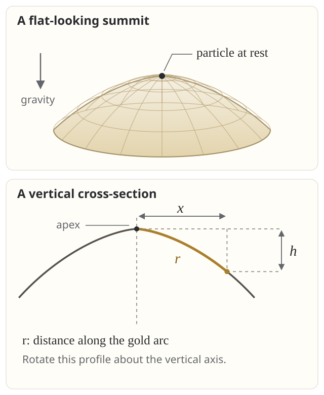

One might have the impression from high-school Newtonian physics: once a system's present state and forces are specified, its future is fixed. The system just evolves according to Newton's law with no rooms for free will. Norton's dome challenges this familiar impression. 
The example invites a closer look at whether that conclusion follows from Newton's laws themselves or from additional assumptions used to solve them.
[Gruff Davies's objections](https://blog.gruffdavies.com/2017/12/24/newtonian-physics-is-deterministic-sorry-norton/) identify several limitations of the model, but their force depends on whether they address the source of its nonuniqueness.

A more fundamental concern is the role of the first law.
Taking it as conceptually prior to the second gives independent weight to its requirement that a body continue at rest or in uniform straight-line motion unless a force compels a change.
Even if the second-law equation allows the particle to depart, does the first law forbid it?

There are three questions here: whether the proposed trajectory solves the equation, whether the dome is an admissible mechanical model, and whether that equation captures everything Newton's laws require.
The first can be settled with a valid solution while the other two require an account of what counts as a Newtonian system and an admissible history.

## Norton's original argument

In [Norton's presentation](https://sites.pitt.edu/~jdnorton/Goodies/Dome/), a point particle slides without friction on a fixed, rotationally symmetric dome in uniform downward gravity.
Let $$r$$ be distance **along the surface** from the apex and $$h$$ the vertical drop below it.
The profile is

$$
h(r)=\frac{2k}{3g}r^{3/2},\qquad k>0.
$$

Here $$g$$ is gravitational acceleration; $$k$$ fixes the dome's shape and has units of length to the power $$1/2$$ divided by time squared.
Norton sets this dimensional coefficient to one in the chosen units.
Keeping it visible avoids a distraction about dimensions.

<figure class="math-figure">
  
  <figcaption>The dome and a vertical cross-section, regenerated from its arc-length parametrization. The gold arc measures r; the dashed horizontal and vertical segments measure x and h. The dot represents a point particle, not a ball with a finite radius. The illustrated dome is truncated before its profile becomes vertical.</figcaption>
</figure>

For a radial slide, write $$\theta$$ for the downward angle of the tangent to the horizontal.
Since $$r$$ measures arc length, $$\sin\theta=dh/dr$$.
The tangential component of gravity therefore gives

$$
\begin{aligned}
F_{\parallel}&=mg\frac{dh}{dr}=mk\sqrt r,\\
\ddot r&=k\sqrt r.
\end{aligned}
$$

This is the tangential equation; maintaining contact with the dome requires a separate check below.
Initially, $$r(0)=\dot r(0)=0$$.
One solution is permanent rest, $$r(t)=0$$.
But for every $$T\geq0$$ there is also

$$
r(t)=
\begin{cases}
0,&t\leq T,\\
\displaystyle\frac{k^2}{144}(t-T)^4,&t>T.
\end{cases}
$$

The particle waits until $$T$$ and then departs along any chosen radial direction.
These are distinct futures with exactly the same initial position and velocity, even the same entire stationary past.
The equation supplies no rule selecting a departure time or direction, and no probability law over them.

Check the trajectory at the joining time

For $$t>T$$,

$$
\begin{aligned}
\dot r(t)&=\frac{k^2}{36}(t-T)^3,\\
\ddot r(t)&=\frac{k^2}{12}(t-T)^2
=k\sqrt{r(t)}.
\end{aligned}
$$

Both derivatives approach zero at $$T$$ and match the stationary branch.
The second derivative also exists at $$T$$ itself and is zero.
Thus the equation holds there as well.
There is no jump in velocity, no impulse, and no instant with positive acceleration but zero tangential force.

The trajectory is $$C^3$$, meaning that its first three derivatives exist and are continuous.
Its fourth derivative does not exist at $$T$$: the one-sided values are zero and $$k^2/6$$.
A classical solution of this second-order equation needs two derivatives, not four.

This is nonuniqueness, not merely sensitivity to small disturbances.
An unstable but deterministic equilibrium can amplify a tiny displacement while still prescribing rest for exactly zero displacement and velocity.
Norton's equation permits departure from those exact data.

## Davies's objections: the outer edge and the apex

Two issues in [Davies's discussion](https://blog.gruffdavies.com/2017/12/24/newtonian-physics-is-deterministic-sorry-norton/) deserve separate treatment.
First, his “infinite force” objection observes that the formula cannot describe a gravity-driven dome at arbitrarily large $$r$$.
Second, he treats the curvature and Lipschitz issue at the apex as incidental, claiming that smooth domes can behave similarly.
The first point correctly limits the model's domain.
The second needs a distinction between instability and nonuniqueness.

### The gravitational force cannot grow without bound

An arc-length parametrization must satisfy $$|dh/dr|\leq1$$.
Here that requires

$$
\frac{k\sqrt r}{g}\leq1,
\qquad
r\leq\frac{g^2}{k^2}.
$$

At the upper endpoint the profile becomes vertical.
Beyond it, the formula cannot represent the stated Euclidean surface: its vertical drop would increase faster than distance traveled along it.
Equivalently, the tangential gravitational force cannot exceed $$mg$$.

We can therefore choose a finite rim strictly inside this bound.
Every delayed trajectory still exists for a positive interval after departure, within an arbitrarily small neighborhood of the apex.
Nonuniqueness of that local motion already defeats uniqueness of the initial-value problem.
No infinite force is needed.

### Lipschitz continuity concerns the force field

For an equation $$\ddot r=f(r)$$, a useful uniqueness condition is **local Lipschitz continuity**:
near each relevant position there must be some finite $$L$$ such that

$$
|f(r_1)-f(r_2)|\leq L|r_1-r_2|.
$$

The condition bounds how fast the force per unit mass can change with position.
For Norton's equation,

$$
\frac{|k\sqrt r-k\sqrt0|}{|r-0|}
=\frac{k}{\sqrt r}\longrightarrow\infty.
$$

The force is continuous at zero and vanishes there, but it is not locally Lipschitz there.
At every strictly positive $$r$$ it is locally Lipschitz.
The problem is therefore neither an infinite force at the apex nor a discontinuity of that force.
It is an unbounded ratio of force change to displacement.

[Fletcher's formulation, §2.1](https://philsci-archive.pitt.edu/8833/4/dome_100711.pdf), makes the locality explicit.
Local Lipschitz regularity of the dynamical field guarantees local uniqueness; it need not hold with one common bound across the entire system.
It is also sufficient, not necessary.
Failure of the condition does not by itself prove indeterminism; the distinct trajectories above do that work.
Fletcher also cautions against imposing it on every classical idealization: even a ball leaving a table encounters an abrupt change in support force.
Such models need rules for transitions, rather than one regularity demand applied indiscriminately. [Fletcher, §3.1](https://philsci-archive.pitt.edu/8833/4/dome_100711.pdf)

## Malament's C1 versus C2 distinction

[Malament (2008), especially §§4–5](https://sites.socsci.uci.edu/~dmalamen/bio/papers/NortonDome.pdf), connects the dynamics to the geometry: the dome is $$C^1$$ but not $$C^2$$ at its summit.
It has a continuous tangent plane there, but its curvature diverges.
For the radial sliding problem on an everywhere $$C^2$$ ramp, his uniqueness argument applies.

We can see the connection directly:

$$
h'(r)=\frac{k}{g}\sqrt r,
\qquad
h''(r)=\frac{k}{2g\sqrt r}\quad(r>0).
$$

The slope tends to zero, so the top looks flat rather than pointed.
But the slope changes too sharply near zero to have a finite second derivative there.
A picture can hide this: a continuous tangent does not imply bounded curvature.

For a general radial profile, the equation is $$\ddot r=gh'(r)$$.
If $$h$$ is $$C^2$$ near the apex, then $$gh'$$ is $$C^1$$, hence locally Lipschitz.
The initial position and velocity then determine a unique local radial slide, within the regime where contact is maintained.
This explains how Malament's geometric condition and Fletcher's dynamical condition fit together.
The $$C^2$$ requirement is a convenient sufficient condition in this ramp problem, not a universal definition of allowable classical geometry.

There are also two different objects whose smoothness we must not confuse.
The **surface** is $$C^1$$ but not $$C^2$$ at its apex.
The **delayed trajectory** is $$C^3$$ but not $$C^4$$ at departure.
Neither statement says that the acceleration along that trajectory is infinite.

An ordinary smooth unstable equilibrium illustrates the difference.
For the linear equation $$\ddot x=\omega^2x$$, the unique solution starting at $$x=\dot x=0$$ is permanent rest.
An incoming solution $$x(t)=Ae^{-\omega t}$$ approaches zero only as $$t\to\infty$$.
Reversing time therefore does not produce a departure from rest at a finite time.
The claim that every smooth unstable summit has Norton's behavior overlooks this distinction.

## What is pathological about the apex?

The surface can push outward on the particle; an ordinary frictionless support cannot pull it inward.
Following a curved path requires inward normal acceleration, supplied here by the inward component of gravity after allowing for the outward support force.
Sufficiently fast motion therefore loses contact.

Malament's striking observation is that **any nonzero tangential launch speed at the apex causes immediate loss of contact**.
The allowable sliding speeds shrink to zero there.
Nevertheless, the delayed departure passes the contact test locally, because its speed vanishes sufficiently rapidly. [Malament, §§5–6](https://sites.socsci.uci.edu/~dmalamen/bio/papers/NortonDome.pdf)

Calculate curvature, support force, and loss of contact

Let $$x(r)$$ be horizontal distance from the axis in a meridional cross-section.
Because $$r$$ is arc length,

$$
\begin{aligned}
x'(r)&=\sqrt{1-\frac{k^2r}{g^2}},\\
x(r)&=\frac{2g^2}{3k^2}
\left[1-\left(1-\frac{k^2r}{g^2}\right)^{3/2}\right].
\end{aligned}
$$

These equations, together with $$h(r)$$, generate the figure above.
In particular, plotting $$h$$ directly against $$r$$ as if $$r$$ were horizontal would give the wrong shape.

The downward tangent angle satisfies $$\sin\theta=k\sqrt r/g$$.
The meridional curvature is therefore

$$
\kappa(r)=\frac{d\theta}{dr}
=\frac{k}{2g\sqrt r\sqrt{1-k^2r/g^2}}.
$$

It diverges as $$r\downarrow0$$.
For radial speed $$v=\dot r$$ and outward normal reaction $$N$$, inward force balance gives

$$
\begin{aligned}
mg\cos\theta-N&=m\kappa v^2,\\
\frac Nm&=g\sqrt{1-\frac{k^2r}{g^2}}
-\frac{kv^2}{2g\sqrt r\sqrt{1-k^2r/g^2}}.
\end{aligned}
$$

Thus, for $$r>0$$, nonnegative support requires

$$
v^2\leq\frac{2g^2}{k}\sqrt r
\left(1-\frac{k^2r}{g^2}\right).
$$

The right side tends to zero at the apex.
A finite nonzero launch speed cannot satisfy this bound arbitrarily close to it.

But Norton's departing branch has

$$
v^2=\frac{4k}{3}r^{3/2}.
$$

Substituting yields

$$
\frac Nm
=\frac{g\left(1-\dfrac{5k^2r}{3g^2}\right)}
{\sqrt{1-k^2r/g^2}}.
$$

The reaction tends to $$mg$$ at departure and is positive for $$0<r<3g^2/(5k^2)$$.
There is no infinite reaction along this trajectory.
If the dome extends that far, the departing particle first loses contact at $$r=3g^2/(5k^2)$$, before the geometrical endpoint.
Choosing an earlier rim leaves the entire illustrated slide in contact.

The distinction is between a singular surface and a singular motion.
An arbitrarily small kick from the apex requires an entirely different continuation—free flight—from the possible zero-speed departures.
That makes an appeal to “what happens after a tiny push” a poor substitute for analyzing the exact initial state.

## Sliding on the dome versus sitting on a golf tee

Malament compares two descriptions at the exceptional state. [See §7](https://sites.socsci.uci.edu/~dmalamen/bio/papers/NortonDome.pdf)

| | Sliding-on-the-dome model | Golf-tee model |
| --- | --- | --- |
| Starting description | Motion follows the surface while contact is possible. | The summit supports the particle; a horizontal launch leads to free flight. |
| Governing equation | $$\ddot r=k\sqrt r$$, with the contact condition. | During flight, $$\ddot x=0$$ and vertical acceleration is $$-g$$. |
| Apex, zero velocity | Permanent rest and delayed slides are admitted. | The zero-launch limit is taken to select rest. |
| Apex, nonzero tangential velocity | No interval of surface sliding is possible. | A ballistic arc initially leaves the surface. |

His concern is **boundary consistency**: two otherwise useful descriptions meet at a state where their prescriptions disagree.

This comparison needs care.
The flight equation is justified while the particle is detached.
The delayed solution remains supported for a positive interval, during which the normal reaction can have a horizontal component.
One cannot simply apply $$\ddot x=0$$ to that slide.
Likewise, at zero launch speed, the golf-tee description is not a particle falling vertically through the dome: support balances gravity.

So the comparison does not establish a contradiction within one fully specified contact model.
It exposes the work done by the choice of how to extend a description to its singular boundary.
Demanding agreement with a chosen limiting family may be sensible, but it is a further modeling requirement that should be stated.

## My objection: what does the first law add?

My initial reaction was that the first law should settle the matter.
There is no net force at the apex, and the particle is at rest.
It should continue at rest until something changes that situation.
Solving $$F=ma$$ cannot by itself establish that every solution respects an independently meaningful law of inertia.

That concern has a close counterpart in [Henrik Zinkernagel's *Causal Fundamentalism in Physics*](https://philsci-archive.pitt.edu/4690/1/CausalFundam.pdf), §§2–3.
He emphasizes the first law's temporal language and its role in the interpretation of inertial frames and time.
On his reading, a force must initiate a change; zero instantaneous acceleration is too weak to constitute a continuing state of rest.
The dome should therefore remain stationary.

I think this identifies the central interpretive issue.
It does not, however, follow just from observing that the force vanishes at one instant.
Consider two claims:

1. **Zero force throughout an interval preserves velocity throughout that interval.**
2. **A particle at a force-free equilibrium cannot leave it unless an independently initiated change supplies a cause.**

The first is already implied by the second-law equation in an inertial frame.
The second imposes a stronger requirement on the allowed history.
Whether the first law includes that requirement is precisely what must be argued.

For the delayed trajectory, force and velocity are zero through $$T$$.
At every later instant, displacement, force, and velocity are positive.
The equation never asks a nonzero acceleration to coexist with zero force.
What it leaves unexplained is the selection of a history in which those quantities become positive at all.

Norton's response is that $$T$$ is the **last instant of rest**, not a first instant of motion.
The set $$t>T$$ has no earliest member: between $$T$$ and any proposed first moving instant lies another moving instant.
That answers the search for an instantaneous violation of $$F=ma$$.
It does not compel someone to accept that the equation exhausts the physical content of inertia. [Norton's first-law discussion](https://sites.pitt.edu/~jdnorton/Goodies/Dome/)

### Fletcher's response, and the history behind the objection

[Fletcher, §3.2](https://philsci-archive.pitt.edu/8833/4/dome_100711.pdf), connects Zinkernagel's reasoning to Poisson's 1806 treatment of nonunique differential equations: Poisson selected continued rest when both velocity and force vanished.
This is an old dispute about selecting physical motions, not a newly discovered algebraic mistake.

Fletcher objects that ordinary forces can turn on continuously without a first instant at which they are nonzero.
He also proposes a saddle-like ridge: a particle already oscillating along it can depart sideways indeterministically.
A first-law argument framed solely around total rest or uniform straight-line motion does not directly address that example; extending it component by component requires further interpretation.

Here is a simple illustration of the first objection.
Prescribe an external force per unit mass

$$
\frac{F(t)}m=
\begin{cases}
0,&t\leq0,\\
\alpha t^2,&t>0,
\end{cases}
\qquad \alpha>0.
$$

From rest at the origin, the uniquely determined trajectory is

$$
x(t)=
\begin{cases}
0,&t\leq0,\\
\displaystyle\frac{\alpha t^4}{12},&t>0.
\end{cases}
$$

Force and acceleration vanish at zero, but motion occurs for every positive time.
The force turns on continuously, with a continuous first derivative.
A blanket rule requiring a positive interval of rest whenever instantaneous force and velocity vanish would exclude this ordinary forced motion too.

There is a meaningful reply: here the external force changes independently of the particle, whereas on the dome the environment is fixed and the force changes because the particle changes position.
That is the strongest version of my concern.
The missing ingredient would be a principle requiring an independent initiating change before a force-free equilibrium can be left.
It would select rest for the dome without denying that a prescribed external force can turn on continuously.

But this principle must be formulated as part of the dynamics or the admissibility of histories.
It is not proved by the equality $$F(T)=0$$.
It also has a consequence: if an incoming particle may reach the apex in finite time and remain there, but its reversed history is forbidden, the permitted histories no longer have the usual time-reversal symmetry of this conservative equation.

Fletcher's broader conclusion is that historical readings of Newton and modern differential-equation formulations can specify different theories.
The determinism question becomes precise only after the admissible models and motions have been specified. [Fletcher, §§3.2 and 4](https://philsci-archive.pitt.edu/8833/4/dome_100711.pdf)

## Three further checks

### Energy is conserved

Set gravitational potential energy to zero at the apex.
Because $$r$$ is arc length, $$\dot r$$ is the particle's full speed during a radial slide.
Thus

$$
\begin{aligned}
E&=\frac12m\dot r^2-mgh(r)\\
&=\frac12m\dot r^2-\frac{2mk}{3}r^{3/2}.
\end{aligned}
$$

Along the departing branch, $$\dot r^2=(4k/3)r^{3/2}$$, so $$E=0$$, just as on the stationary branch.
Gravity supplies the kinetic energy through the loss of height.
Energy conservation does not select a departure time.

Davies suggests that horizontal kinetic energy has been omitted and questions the joining of the trajectories because their fourth derivatives differ. [His energy and “stitch” sections](https://blog.gruffdavies.com/2017/12/24/newtonian-physics-is-deterministic-sorry-norton/)
But the expression $$m\dot r^2/2$$ already includes both horizontal and vertical motion.
Adding horizontal kinetic energy again would count it twice.
Moreover, the surface-sliding solution must cease to describe a freely supported particle once contact is lost; extrapolating it to the vertical rim is not a valid energy test.

### The join does not hide a kick

Joining a stationary trajectory to uniform motion at nonzero speed creates a velocity jump and requires an impulse.
Joining the two dome branches does neither.
Position, velocity, acceleration, and jerk all match.

The fourth derivative, sometimes called snap, is not an independently specified state variable in this second-order model.
Demanding its continuity would change the class of allowed solutions.
That may be proposed as an additional rule, but it does not identify a failure to satisfy the given equation.
It also would not distinguish different future departure times while the particle is still in the interior of its stationary waiting period: there, every time derivative is zero.

### The singular surface is not the only route

Fletcher also gives an electrostatic construction with $$\rho(r)\propto r^{-1/2}$$ near the center, producing an outward field $$E_r(r)\propto\sqrt r$$.
It reproduces the same nonuniqueness without a contact surface, although the charge density diverges integrably at the center. [Fletcher, §3.4](https://philsci-archive.pitt.edu/8833/4/dome_100711.pdf)

Rejecting singular domes therefore does not settle every version of the question.
One must also say which force fields, material distributions, and idealizations the intended formulation permits.
Conversely, reproducing the equation in another idealization does not show that a laboratory system will spontaneously move.

## What I take from the dome

The mathematical result is secure: the specified initial-value problem has multiple solutions, including locally admissible supported departures.
The larger claim about Newtonian mechanics depends on what belongs to the theory beyond that equation.

My first-law objection remains useful because it asks whether a solution must also satisfy a temporal or causal requirement that the differential equation does not express.
It becomes a resolution only when that requirement is stated precisely and its consequences are accepted.
Malament's boundary problem asks a parallel question about contact; Fletcher asks which formulation serves the purpose at hand.

For me, the dome's value is that it makes these usually hidden choices visible.
If determinism is meant to be a conclusion, the assumptions that deliver uniqueness must be part of the argument.

## Sources and further reading

- John D. Norton, [*The Dome: A Simple Violation of Determinism in Newtonian Mechanics*](https://sites.pitt.edu/~jdnorton/Goodies/Dome/). The original accessible presentation, based on his 2003 paper *Causation as Folk Science*.
- John D. Norton (2008), [*The Dome: An Unexpectedly Simple Failure of Determinism*](https://sites.pitt.edu/~jdnorton/papers/DomePSA2006_short.pdf), *Philosophy of Science* 75: 786–798. Defense of the example and discussion of admissible idealizations; link to the author's manuscript.
- David B. Malament (2008), [*Norton's Slippery Slope*](https://sites.socsci.uci.edu/~dmalamen/bio/papers/NortonDome.pdf), *Philosophy of Science* 75: 799–816. Geometry, contact, phase space, and the competing descriptions at the apex.
- Henrik Zinkernagel (2010), [*Causal Fundamentalism in Physics*](https://philsci-archive.pitt.edu/4690/1/CausalFundam.pdf), in *EPSA Philosophical Issues in the Sciences*, pp. 311–322. The independent role and temporal interpretation of Newton's first law; link to a preprint.
- Samuel C. Fletcher (2012), [*What Counts as a Newtonian System? The View from Norton's Dome*](https://philsci-archive.pitt.edu/8833/4/dome_100711.pdf), *European Journal for Philosophy of Science* 2: 275–297. Sections 2.1, 3.1, 3.2, and 3.4 address local Lipschitz continuity, regularity restrictions, the first law and Poisson, and alternative constructions. The historical account here follows Fletcher; link to the accepted manuscript.
- Gruff Davies (2017, updated 2020), [*Newtonian physics IS deterministic (sorry Norton)*](https://blog.gruffdavies.com/2017/12/24/newtonian-physics-is-deterministic-sorry-norton/). The critical essay that prompted this comparison.
