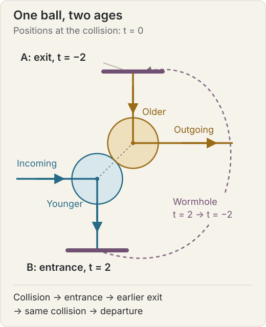

The familiar instruction to time travelers—do not change anything—becomes puzzling as soon as we take it literally.
Breathing changes the air.
Standing in a room changes the light, the temperature, and the motion of the people walking around you.
There is no obvious physical boundary between an insignificant disturbance and one that changes someone's life.

**Novikov's self-consistency principle** offers a different way to think about the problem.
If travel into the past is possible, the traveler's actions must fit into one consistent history.
The breathing, the conversation, and the intervention were already part of what happened.
There is no earlier version of history in which the traveler was absent, followed by a revised version in which the traveler arrived.

That sounds like a rule for writing science fiction.
It is also a serious proposal about how to formulate physics in a spacetime where causes can loop back on themselves.
Its mathematical content is easiest to see by separating three questions: what the local laws allow, whether their solutions fit together globally, and whether that fit is unique.

## How a science-fiction problem became a physics problem

In general relativity, spacetime geometry determines which paths a physical observer can follow.
A **closed timelike curve**, or CTC, is a path that always points toward the traveler's local future but eventually returns to its starting spacetime event.
A clock carried along the path keeps advancing; the difficulty appears when we try to order the entire path from an outside perspective.

This possibility did not originate with Novikov.
Gödel's [1949 rotating-universe solution](https://doi.org/10.1103/RevModPhys.21.447) showed that Einstein's equations admit geometries containing CTCs.
That establishes a mathematical possibility within the equations, not a description of our observed universe.

Science fiction did help stimulate a later, more concrete research program.
Carl Sagan's work on *Contact* prompted discussions with Kip Thorne about interstellar travel through wormholes, reflected in Morris and Thorne's [1988 paper on traversable wormholes](https://doi.org/10.1119/1.15620).
A wormhole is a hypothetical connection between regions of spacetime whose route through the connection can be much shorter than the outside route.

Morris, Thorne, and Yurtsever then argued that, **if a traversable wormhole could be created and maintained**, a time offset between its mouths could turn it into a time machine.
Differential aging of the mouths supplies the basic idea: entering one mouth can lead to an exit that external clocks label as earlier.
Their [1988 time-machine paper](https://doi.org/10.1103/PhysRevLett.61.1446) makes the conditional nature of this construction essential.
The existence and stability of the required wormholes are separate physical questions.

Novikov discussed the need for consistent histories in his [1989 analysis of a time machine](https://www.jetp.ras.ru/cgi-bin/dn/e_068_03_0439.pdf).
Friedman, Morris, Novikov, Echeverria, Klinkhammer, Thorne, and Yurtsever gave an explicit global formulation in [1990](https://doi.org/10.1103/PhysRevD.42.1915).
Their question was whether familiar local laws could still fit together when spacetime allowed a return to the past.

## Local laws, global histories

For readers comfortable with a little notation, a smooth closed timelike curve can be written as a path $$\gamma(\tau)$$ satisfying

$$
\gamma(0)=\gamma(T),\qquad T>0,
$$

with a future-directed tangent obeying

$$
g_{\mu\nu}\dot\gamma^\mu\dot\gamma^\nu<0.
$$

Here $$g_{\mu\nu}$$ is the spacetime metric, we use the sign convention $$(-,+,+,+)$$, and a dot means differentiation along the path.
The inequality says that the path is timelike: locally it is an allowed path for a massive observer.
The equality says that the path closes.

Ordinary equations of motion are local.
They tell a ball how to accelerate or a field how to vary in a small neighborhood.
Novikov's requirement is global: the pieces must describe the same physical state wherever the geometry makes them meet again.

For example, take a fixed spacetime $$M$$ with metric $$g$$ and a real, massless scalar field $$\phi$$ obeying

$$
\Box_g\phi=0,
$$

where $$\Box_g$$ is the wave operator in that geometry.
Suppose we have specified a local solution $$\phi_U$$ on a region $$U$$.
The consistency requirement is that there exist a sufficiently regular, single-valued field on the whole nonsingular spacetime such that

$$
\begin{cases}
\Box_g\phi=0 & \text{throughout }M,\\
\phi|_U=\phi_U. &
\end{cases}
$$

The second line means that the global field agrees with the local field we started with.
This is a mathematical illustration of the [global-extension principle](https://doi.org/10.1103/PhysRevD.42.1915); a theory with interacting matter and dynamical gravity would require the full coupled equations as well.

Neither the existence nor the uniqueness of such an extension is guaranteed in this statment. 

## History as a fixed point

There is a useful way to make the global condition more concrete.
Imagine cutting a causal loop at the exit of a wormhole.
Specify the state emerging there: its arrival time, position, velocity, and whatever other variables the model requires.
Call that state $$x$$.

Hold the external incoming data fixed.
Let the system evolve, including any interactions with its younger self, until it enters the wormhole.
Apply the wormhole's rule for transporting that state back to the exit.
When this construction defines a return map $$F$$, consistency requires

$$
\boxed{x=F(x).}
$$

The state we assumed would emerge must equal the state the resulting history actually sends back.
For a field, $$x$$ might be an entire function rather than a short vector.
For more complicated dynamics, a system of matching equations can be more appropriate than a single-valued map.
The underlying requirement is the same.

A bit sent into the past shows why existence and uniqueness must be kept separate.
Let $$x\in\{0,1\}$$ be the received bit, and let a device send $$F(x)$$ back to that same receiving event.

| Device rule | Consistency equation | Allowed histories |
| --- | --- | --- |
| Copy the bit | $$x=x$$ | Both 0 and 1 |
| Always send 0 | $$x=0$$ | Only 0 |
| Flip the bit | $$x=1-x$$ | Neither 0 nor 1 |

The last row is a contradiction within the stipulated classical model.
The solution $$x=1/2$$ is unavailable because a classical bit is either 0 or 1.
Assigning equal probabilities to the two values does not make an individual history satisfy the equation.

Novikov's principle excludes the complete, perfectly functioning bit-flipping loop as described.
It, however, does not tell us whether a real attempt would fail because the machine cannot be built, the device does not implement the assumed rule, or some other premise fails.

## A billiard ball meets its younger self

The classic physical puzzle replaces a would-be murderer of their own grandfather with a billiard ball.
Send a ball toward a wormhole that returns it to an earlier time.
Arrange the geometry so that the older ball appears to knock the younger ball away from the entrance.
Then the younger ball never enters, so the older ball cannot emerge to deliver the collision.

The tempting mistake is to combine pieces from incompatible trajectories: use the collision-free path to determine the older ball's arrival, then add a collision that destroys the path which produced it.
A valid solution must determine the arrival and collision together.

Echeverria, Klinkhammer, and Thorne's [1991 billiard-ball paper](https://doi.org/10.1103/PhysRevD.44.1077) did just that.
For a broad class of apparently dangerous incoming trajectories, they found infinitely many self-consistent solutions.
Their result concerns a specified model and class of trajectories; it is not a theorem that every conceivable time machine has a solution.

We can check one self-consistent collision explicitly without reproducing their full geometry.
The following construction is an elementary illustration, with a prescribed wormhole connection and Newtonian motion outside it.

### An exactly solvable loop

Represent the ball in a plane as a perfectly elastic, frictionless disk with radius $$1/\sqrt2$$ and mass $$m$$.
Choose units in which its nonrelativistic speed is 1.
The wormhole connects an entrance at $$B=(0,-2)$$ to an exit at $$A=(1,3)$$.
Our idealized boundary rule maps the disk's center at $$B$$ to $$A$$, four time units earlier, preserving its velocity.
We neglect the thickness and transit duration of the connection and any forces away from collisions.

At external time $$t=0$$, let the younger disk have center $$(0,0)$$ and velocity $$(1,0)$$.
Let its older version have center $$(1,1)$$ and velocity $$(0,-1)$$.
Their centers are $$\sqrt2$$ apart, exactly the sum of their radii, so they are touching.

<figure class="math-figure">
  
  <figcaption>A spatial diagram of one consistent history. The disks show the two ages at the collision; the arrows trace their center paths. The dashed connection is the wormhole identification, not a path through the surrounding space.</figcaption>
</figure>

The elastic collision exchanges these two velocities.
The younger disk turns downward; the older disk turns right.
Now follow the younger disk along its own journey:

1. It collides at $$t=0$$ and travels down from $$(0,0)$$ to $$B=(0,-2)$$, arriving at $$t=2$$.
2. The wormhole takes it from $$t=2$$ to $$t=-2$$ at $$A=(1,3)$$, still moving downward.
3. It travels down for two time units and reaches $$(1,1)$$ at $$t=0$$, supplying precisely the older disk assumed in the collision.
4. After striking its younger self, it moves to the right and leaves the scene.

Everything matches: position, time, velocity, and the collision law.
The impact causes the trip that supplies the impact.

Check the collision and the full trajectory

Write the incoming velocities as $$u=(1,0)$$ for the younger disk and $$v=(0,-1)$$ for the older disk.
The unit vector from the younger center to the older center is

$$
n=\frac{(1,1)}{\sqrt2}.
$$

For frictionless disks, the impulse acts along $$n$$.
For equal masses and a perfectly elastic collision, conservation of momentum and reversal of the relative normal velocity give

$$
\begin{aligned}
u'&=u-[(u-v)\cdot n]n,\\
v'&=v+[(u-v)\cdot n]n.
\end{aligned}
$$

To derive this, write the impulse on the older disk as $$Jn$$ and that on the younger disk as $$-Jn$$.
Then $$u'=u-(J/m)n$$ and $$v'=v+(J/m)n$$.
The restitution condition

$$
(u'-v')\cdot n=-(u-v)\cdot n
$$

implies $$J/m=(u-v)\cdot n$$, yielding the displayed formulas.
Here $$(u-v)\cdot n=\sqrt2$$, so

$$
\begin{aligned}
u'&=(1,0)-(1,1)=(0,-1),\\
v'&=(0,-1)+(1,1)=(1,0).
\end{aligned}
$$

Total momentum is $$m(1,-1)$$ before and after the impact.
Total kinetic energy is $$m$$ before and after it, because both speeds remain 1.

The younger center follows

$$
q_{\mathrm{young}}(t)=
\begin{cases}
(t,0),&t\leq0,\\
(0,-t),&0\leq t\leq2.
\end{cases}
$$

The older center follows

$$
q_{\mathrm{old}}(t)=
\begin{cases}
(1,1-t),&-2\leq t\leq0,\\
(1+t,1),&t\geq0.
\end{cases}
$$

The endpoint and velocity matching conditions are exactly the stipulated wormhole rule:

$$
\begin{aligned}
(q_{\mathrm{young}}(2),\dot q_{\mathrm{young}}(2^-))
&=((0,-2),(0,-1)),\\
(q_{\mathrm{old}}(-2),\dot q_{\mathrm{old}}(-2^+))
&=((1,3),(0,-1)).
\end{aligned}
$$

There is no hidden extra collision.
For $$-2\leq t\leq2$$, when both versions exist, the distance between their centers is

$$
\lVert q_{\mathrm{old}}(t)-q_{\mathrm{young}}(t)\rVert
=\sqrt2(1+|t|).
$$

It equals the sum of the radii only at $$t=0$$ and is strictly larger otherwise.
The two versions approach before the collision and separate afterward.
This verifies the entire proposed trajectory within the idealized model.

This particular construction also has a second solution for the same incoming path: the ball can simply continue along $$(t,0)$$ forever, miss both mouths, and never encounter an older version.
Thus even this small example demonstrates **nonuniqueness**.
The incoming motion by itself does not tell us which globally consistent history occurs.
It is a simpler illustration than the original paradoxical setup, where the unperturbed path enters the wormhole.

## What about breathing, chaos, and free will?

Return to the traveler who disturbs the air.
In a self-consistent history, those disturbances belong to the physical state being solved for.
The principle has no exemption for small changes and no special prohibition reserved for large ones.
What matters is whether the whole account is compatible with itself.

Chaos makes nearby initial conditions produce very different later outcomes.
That can make finding or predicting consistent histories difficult.
It does not imply that a history must repair itself after a perturbation, or that every possible intervention admits a consistent completion.

The distinction is between two claims:

- A realized history must be consistent with the interactions it contains.
- A realized history must remain unchanged under every imaginable replacement of those interactions.

Only the first expresses the consistency requirement.
Changing a device, a decision rule, or an incoming state changes the mathematical problem.
The new problem may have different solutions or no solution under the stipulated assumptions.

Your actions can still have causes and consequences.
The ball's collision is indispensable to its looping trajectory.
Likewise, a traveler's warning might be the reason someone survives; it must then belong to the history in which that person survived.
Whether such a picture allows the kind of free will we care about is a further philosophical question.
The consistency equation alone does not settle it.

A **bootstrap loop** raises a related but different puzzle.
Suppose an older traveler gives a younger traveler a proof, which the younger traveler later carries back and hands over.
If the proof is copied exactly, the information matches around the loop, but there may be no first act of discovery.
That is an explanatory puzzle rather than the contradiction in $$x=1-x$$ for a bit.
Any complete physical model must also account for the carrier's energy, wear, and other state variables; copying an abstract string is not a complete model of a book aging around a loop.

## The idea in fiction—and fiction in the idea

Fixed-history stories existed before the modern physics literature, so resemblance alone is not evidence that a writer borrowed from Novikov.
The more interesting relationship runs in both directions: fiction supplies questions, physics sharpens them, and fiction explores what the answers might mean for a person.

There is a particularly clear example in Ted Chiang's *The Merchant and the Alchemist's Gate*.
In a [2019 interview](https://www.manifold1.com/episodes/ted-chiang-on-free-will-time-travel-many-worlds-genetic-engineering-and-hard-science-fiction-19/transcript), Chiang explicitly identifies Thorne's discussion of the billiard-ball time machine as an inspiration.
He wanted to explore a fixed past without making the result inevitably despairing.
Understanding, regret, and reconciliation can change even when the events being understood cannot.

The following are useful ways to read several stories through the principle, rather than claims that every work implements the same physical theory.
The descriptions mention their time-travel structure while avoiding their central plot revelations.

| Work | Connection to self-consistency |
| --- | --- |
| *La Jetée* and *Twelve Monkeys* | Memory and later experience fit into a single causal history. The latter's [production notes](https://www.gilliamdreams.com/12-monkeys-prod) explicitly trace its inspiration to the former. The tension is discovering how the pieces fit. |
| *All You Zombies* and *Predestination* | Personal identity becomes entangled with causal loops. [The film adapts Heinlein's story](https://www.sonypictures.com/movies/predestination). The bootstrap question becomes a question about a person's own origin. |
| *Los cronocrímenes* (*Timecrimes*) | Attempts to escape a predicament help produce it. Its [distributor's account](https://magpictures.com/profile.aspx?id=c249edca-6e66-4d7d-b085-f7bac8cb827d) emphasizes the protagonist's increasing involvement in the events he tries to fix. |
| *Dark* | Interlocking generations and encounters across time make causal loops central to its mystery. Its later use of multiple worlds complicates a strict single-history reading; it is not a pure illustration of one Novikov model. [Series page](https://www.netflix.com/title/80100172). |
| *The Merchant and the Alchemist's Gate* | Visiting the past changes the traveler's understanding of it. The scientific connection is documented by Chiang's own account, and the emotional possibilities extend beyond fatalism. |

Stories about rewriting a timeline or moving between alternative histories ask a different question.
If a traveler prevents an event in another branch while the original branch still exists, the story has changed the relationship between the histories.
It has not shown that contradictory descriptions can hold at the same event in one history.

The appeal of the fixed-history story is that a familiar scene can acquire a new explanation without any of its events being replaced.
The audience experiences a revision in knowledge rather than a revision in the world.
There is a thematic connection to the [forty cheating husbands puzzle](/fun-stuff/logics/forty-cheating-husbands.html): what someone can infer changes even when an underlying fact was already true.
The mechanisms are different—public information in one case, causal loops in the other—but both reward asking what was known, as distinct from what happened.

## Consistency is not a time-machine construction manual

Novikov's proposal asks how histories must fit together **if** backward time travel is available.
Hawking's [chronology protection conjecture](https://doi.org/10.1103/PhysRevD.46.603) instead proposes that physical laws prevent the formation of closed timelike curves.
His work investigates whether quantum effects and their gravitational backreaction obstruct the creation of a time machine.
This is a different proposed resolution of the problem, not a consequence of the fixed-point equation.

The billiard-ball calculation establishes something narrower and useful: ordinary collision mechanics can coexist with a prescribed backward-time connection in a globally consistent model.
It does not establish that nature provides that connection, that every incoming state can be accommodated, or that the resulting history is unique.

The original breathing question therefore has a precise answer within Novikov's picture.
A traveler does interact with the past, down to the air molecules.
Those interactions must belong to the same history that contains the journey.
The mathematical task is to find a complete history in which the departure, arrival, and consequences all agree.

## Further reading

- Michael S. Morris and Kip S. Thorne (1988), [*Wormholes in spacetime and their use for interstellar travel: A tool for teaching general relativity*](https://doi.org/10.1119/1.15620). The traversable-wormhole framework and its connection to *Contact*.
- Michael S. Morris, Kip S. Thorne, and Ulvi Yurtsever (1988), [*Wormholes, Time Machines, and the Weak Energy Condition*](https://doi.org/10.1103/PhysRevLett.61.1446). The conditional conversion of a traversable wormhole into a time machine.
- Igor D. Novikov (1989), [*An analysis of the operation of a time machine*](https://www.jetp.ras.ru/cgi-bin/dn/e_068_03_0439.pdf). An early discussion of global consistency and restrictions on initial data.
- John Friedman and coauthors (1990), [*Cauchy problem in spacetimes with closed timelike curves*](https://doi.org/10.1103/PhysRevD.42.1915). The global principle and model field equations.
- Fernando Echeverria, Gunnar Klinkhammer, and Kip S. Thorne (1991), [*Billiard balls in wormhole spacetimes with closed timelike curves: Classical theory*](https://doi.org/10.1103/PhysRevD.44.1077). Consistent self-collisions and the failure of uniqueness.
- Stephen W. Hawking (1992), [*Chronology protection conjecture*](https://doi.org/10.1103/PhysRevD.46.603). The possibility that physics prevents time machines from forming.
