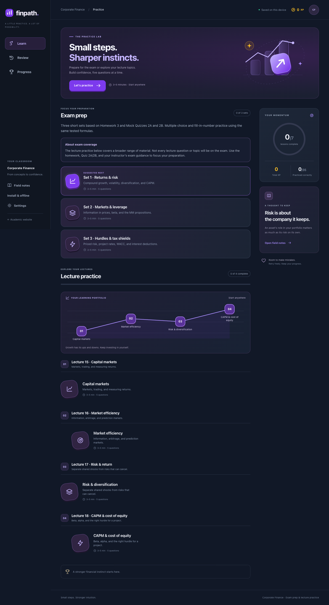
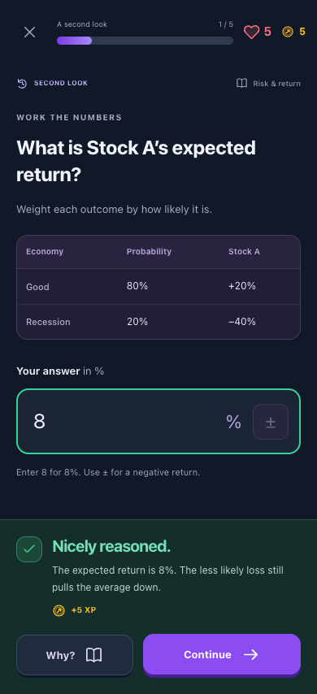
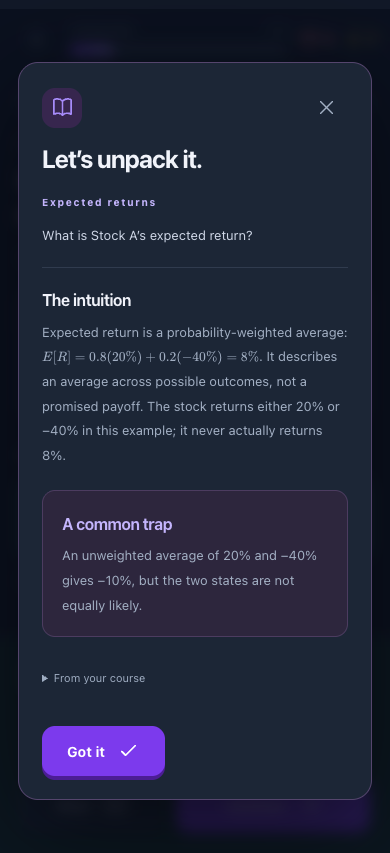

# Finpath — Corporate Finance Practice

An installable, static, mobile-friendly Corporate Finance practice app with three exam-prep sets followed by Lectures 15–18: seven short lessons, 35 source-grounded questions, and a reusable exercise engine. It lives entirely under `/practice/` and does not change the academic website’s navigation, theme, or deployment configuration.

## Preview

From the website repository root:

```sh
python3 -m http.server 8765 --bind 127.0.0.1
```

Open `http://127.0.0.1:8765/practice/`. Use HTTP rather than opening `index.html` as a file, because the engine fetches JSON. There is no build step, backend, account, analytics, AI tutor, or API key. KaTeX 0.19.0 and its fonts are bundled under `assets/katex/` with the upstream MIT license. Icons and the hero illustration are original SVG.

GitHub Pages can serve this directory unchanged. All application resources use relative URLs; HTML has no Jekyll front matter. The existing `_config.yml` and production pages are untouched. Review the feature branch and merge only when ready to publish.



| Answer feedback                              | Prewritten explanation                             |
| -------------------------------------------- | -------------------------------------------------- |
|  |  |

## Exam prep

Three five-question sets appear before the lecture path. They use only multiple choice and numerical input, with five whole-number calculation answers using the same formulas as Homework 3 and Mock Quizzes 2A/2B. The three sets collectively cover the ten concept checks and five calculation formulas in those practice materials. See [the question/source map](docs/exam-prep.md).

The visible scope notice explains that the lecture practice covers a broader range: not every lecture question or topic will be on the exam. Exam prep is voluntary, open from the start, and saved independently using the existing progress store. All existing lecture IDs and questions remain unchanged.

## Lecture topics

Each topic has five questions, selected from its `Lec` core deck and checked against the full lecture and associated textbook sections. No `Module` slide content is used.

| Lecture | Topic                  | Five question focuses                                                                                            |
| ------- | ---------------------- | ---------------------------------------------------------------------------------------------------------------- |
| 15      | Capital markets        | Compound annual return; limit orders; market instruments; brokers/dealers; volatility                            |
| 16      | Market efficiency      | Efficiency forms; arbitrage sequence; limits to arbitrage; YES/NO pricing; payoff replication                    |
| 17      | Risk & diversification | Risk types; independent versus correlated losses; priced risk; industry concentration; corporate diversification |
| 18      | CAPM & cost of equity  | CAPM return; alpha; beta interpretation; beta drivers; project hurdle rates                                      |

## Learning behavior

- Seven lessons, five questions each, targeting approximately 3–5 minutes per lesson. Timing is an estimate, not a measured student outcome.
- Multiple choice, true/false, matching, sequence, and numerical questions. Choices and matching definitions are shuffled once per question visit and retain their order on reload.
- A correct first-pass answer earns 10 XP. Review answers earn 5 XP. Consecutive correct answers add 2, 4, then at most 6 bonus XP. Errors break the combo. Repeated practice can earn more XP.
- Incorrect submissions cost one heart, reveal the answer, and enter the review queue. Lessons stay at five questions. Review is optional and separate; review sessions contain up to five questions.
- Five hearts reset for each session. At zero, practice continues with no further penalty. Earned XP and completed lessons are retained.
- Every lesson is open from the beginning. Students can skip ahead, revisit completed lessons, or switch between unfinished attempts. The upward-trending path includes dips and suggests a journey without enforcing prerequisites. Coin icons represent XP. Best scores measure accuracy on each five-question attempt; review sessions do not change lesson scores.
- “Practiced correctly” counts distinct questions answered correctly at least once. It is an activity indicator, not a claim of permanent mastery. Full marks means a 100% best first-pass score.
- “Why?” opens prewritten intuition, a common misconception, and the relevant source section. No generated tutoring or external calls occur.

## Persistence and controls

Progress is stored under `finpath:corporate-finance` in this browser’s `localStorage`. It includes completed lessons, XP, best scores, full submitted-answer history, completion records, and a separate unfinished attempt for each lesson. Drafts, question positions, shuffled orders, hearts, combos, and feedback save immediately. Reloading an answered question cannot award XP twice. A change from another tab reloads the current tab to the latest saved state. Existing v1 progress migrates automatically. Curriculum changes retain earlier XP, scores, and answer history; retired unfinished attempts and review IDs are archived intact for export. New lecture topics have separate completion records.

Use the lesson’s × button to return to the path; saving also happens automatically without pressing it. The active lesson resumes on reload or reopening the same browser. Switching topics parks the previous attempt for later. Settings includes JSON export and a two-step reset limited to this application’s progress. Export is a record/backup; import is not included in this prototype. Invalid stored data is preserved until explicitly reset; storage failures are displayed rather than silently claiming a save. There is no cross-device synchronization, and clearing browser data removes progress. The versioned storage contract separates persistence from scoring, so a future cloud adapter can be added without changing the quiz engine. See [the storage and caching design](docs/progress-storage.md).

Use number keys to select choices and Enter to check or continue. Tab and Space work for other controls. Matching uses concept/definition buttons; sequence questions use up/down buttons, including on touch devices. A ± button supports negative returns even when a mobile numeric keyboard omits a minus key. Explanations use a native modal with Escape dismissal and focus containment. Reduced-motion preferences suppress animation.

## Install and practice offline

Open **Settings → Take Finpath with you** for installation and offline controls. iPhone/iPad users can use Safari’s **Share → Add to Home Screen**; Android users can use Chrome’s **Install app** menu or the install button when offered. The app launches in standalone mode with original violet icons.

The homepage fetches only the small course index. A lesson’s question file and locally bundled math assets load when needed. Answers and drafts are processed and saved locally; there are no answer-submission requests. The service worker caches the application shell and requested static files, so previously opened lessons can be resumed offline. Choose **Save all lessons offline** to download the entire course, including math and explanations (about 0.8 MB), without opening each lesson first. Otherwise, an unvisited lesson needs connectivity. No external service, paid dependency, or backend is needed. Updates verify new files before activation, wait for open app windows to close, and preserve local progress. See [PWA deployment and native packaging](docs/pwa-and-packaging.md) for Cloudflare cache guidance, the update process, and future iOS/Android wrappers.

## Add content

See [the content guide](docs/content-guide.md), [course manifest schema](courses/course.schema.json), and [lesson schema](courses/lesson.schema.json). To add a lecture, create a new lesson JSON file, add its filename to `course.json`, and run `npm run content:index` to refresh the lightweight metadata index. The game engine does not need to change. Keep IDs stable for the same content; use new IDs for replacement exercises so old completions cannot be mistaken for new learning.

See [the source and verification record](docs/verification.md) for provenance and test coverage.

## Development checks

Development dependencies are optional for students and static hosting. Node.js 20+ and Python 3 are used for the checks:

```sh
cd practice
npm ci
npm run content:index
npm run pwa:assets
npm run pwa:check
npm run validate
npm test
npm run verify:math
npx playwright install chromium
```

With the preview server running from the repository root:

```sh
npm run test:browser
```

To use an installed Chromium browser instead:

```sh
BROWSER_EXECUTABLE="/Applications/Microsoft Edge.app/Contents/MacOS/Microsoft Edge" npm run test:browser
```

Set `BASE_URL` if the server uses a different port or path. Browser checks write screenshots to the ignored `test-results/` folder. Set `TEST_WEBKIT=1` after installing Playwright WebKit for the iPhone engine pass. `npm run package:native` prepares the same app for a future native wrapper without installing any SDK. The development packages are Playwright, Ajv, and axe-core; none is requested by the student-facing page.
